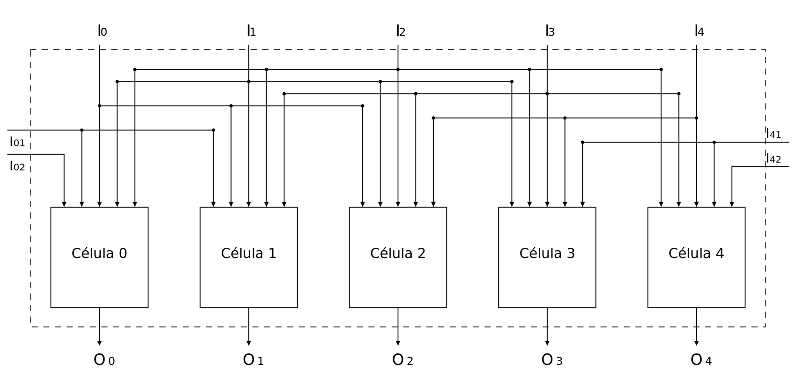

# Circuitos integrados: miniACA y cadena de retardos (TFF)

Diseños digitales en **Verilog** presentados a **Silicluster 2025** por Raúl Lopresti, Luciana De Micco y Maximiliano Antonelli (Facultad de Ingeniería, Universidad Nacional de Mar del Plata, Argentina).

El repositorio reúne los **archivos RTL y testbenches originales**, las descripciones técnicas, los diagramas disponibles, las imágenes de layout GDS y material de referencia sobre placas Caravel.

| Circuito | Módulo Verilog | Identificador Silicluster | Descripción |
| --- | --- | --- | --- |
| [miniACA](miniACA/README.md) | `miniaca` | `c2p9` | Autómata celular asincrónico programable de cinco células, con LUT compartida de 32 bits y 5 bits de condición inicial |
| [retardos](retardos/README.md) | `tffchain` | `c2p10` | Cinco cadenas independientes de dos flip-flops T, con salidas `/2` y `/4` respecto de cada entrada |

<!-- INICIO: modos de funcionamiento -->
## miniACA — autómata celular programable (`c2p9`)

### Modo de uso (`Prog = 0`)



Cada una de las **cinco células** recibe **cinco entradas**: su entrada `I` correspondiente y las entradas de las dos posiciones vecinas a cada lado. En los extremos se utilizan las entradas adicionales `I01`, `I02`, `I41` e `I42`, que permiten conectar otro CI o cerrar la realimentación externamente. Cada célula aplica la misma **regla configurable de 32 bits** y entrega su resultado en `O[4:0]`.

### Modo de programación (`Prog = 1`)

Se cargan en serie los **32 bits de la regla** y los **5 bits de la condición inicial** en un registro de 37 flip-flops. Las señales `I[0]` (Reset), `I[1]` (Enable), `I[2]` (Data) y `Clock` controlan la carga. En este modo, `O[4:0]` muestra la condición inicial almacenada.

*Esquema del modo de programación: pendiente de incorporar.*

## Cadena de flip-flops T — `tffchain` (`c2p10`)

El segundo circuito contiene **cinco cadenas independientes**, cada una con dos flip-flops T en cascada. Cada entrada `i_x1[i]` hace conmutar la primera etapa (`o_x2[i]`) y esta activa la segunda (`o_x4[i]`). Para una señal periódica, las frecuencias de salida son la mitad y la cuarta parte de la frecuencia de entrada. Ambas etapas comparten un reset asincrónico activo en alto (`i_rst`).

*Esquema de la cadena de flip-flops: pendiente de incorporar.*

<!-- FIN: modos de funcionamiento -->

## Archivos principales

```text
IC_automatas_retardos/
├── README.md
├── miniACA/
│   ├── README.md
│   ├── miniaca.v                       # Verilog original
│   ├── miniaca_tb.v                    # Testbench original
│   ├── tests/miniaca_autocheck_tb.v    # Testbench autoverificable añadido
│   └── docs/                           # Descripción PDF, diagrama draw.io, layout GDS
├── retardos/
│   ├── README.md
│   ├── tffchain.v                      # Verilog original
│   ├── tffchain_tb.v                   # Testbench original
│   ├── tests/tffchain_autocheck_tb.v   # Testbench autoverificable añadido
│   └── docs/                           # Descripción PDF, layout GDS
├── docs/
│   ├── silicluster/                    # Constancias de convocatoria
│   └── hardware/                       # Referencias de tarjetas Caravel
├── scripts/simular.sh
├── scripts/simular.ps1
├── publicar_github.ps1                 # Publicación en un repositorio privado nuevo
└── .github/workflows/verilog.yml       # Pruebas automáticas en GitHub Actions
```

## Simulación

Instalar [Icarus Verilog](https://steveicarus.github.io/iverilog/) (`iverilog` y `vvp`). Desde la raíz:

**Linux / bash:**

```bash
bash scripts/simular.sh
```

**Windows / PowerShell:**

```powershell
.\scripts\simular.ps1
```

Los scripts compilan **ambos circuitos** y ejecutan los testbenches autoverificables. Los archivos VCD y ejecutables se generan en `simulaciones/`, excluido de Git. El flujo de GitHub Actions usa Icarus Verilog para repetir estas pruebas al enviar cambios.

Los testbenches originales (`miniaca_tb.v` y `tffchain_tb.v`) se incluyen **sin modificaciones**, a modo de referencia de los archivos enviados. No realizan comprobaciones automáticas de todas las salidas; por eso se agregaron las pruebas autoverificables.

## Condiciones de implementación

- **miniACA:** los 37 flip-flops pertenecen al registro de configuración, no a los cinco estados de las células. El cálculo de las salidas en modo ejecución es combinacional y puede entrar en lazos de realimentación u oscilar si se conectan las salidas a las entradas. El reloj se utiliza únicamente para programar la configuración. Ver [detalle](miniACA/README.md).
- **retardos:** el diseño implementado es una **cadena de divisores por toggling**, no una línea que garantice un retardo temporal fijo. Cada entrada de reloj es independiente. Ver [detalle](retardos/README.md).
- **Integración física:** las imágenes GDS y los tags de Silicluster documentan la convocatoria, pero **no contienen un pinout de encapsulado confirmado** ni reemplazan la asignación de pines provista por el fabricante.

## Material adicional

Los archivos `docs/hardware/` son referencias de una tarjeta M.2/Caravel, no parte del RTL. El ZIP grande `caravel_board-main.zip` (aprox. 91 MB), también presente en el Drive de origen, **no se duplica aquí**: está disponible en el [proyecto original de chipfoundry/caravel_board](https://github.com/chipfoundry/caravel_board) y en la [carpeta de Drive compartida](https://drive.google.com/drive/folders/1gQ6yE9ZW2dxFafuSmnaarN-BUkWn-Ljd). Se conservaron las imágenes, planos y planilla que acompañan ese material.

Las constancias de Silicluster pueden contener datos de contacto. **Se recomienda mantener privado el repositorio** o revisar esas dos constancias antes de cambiar su visibilidad a pública. El script de publicación usa el modo **privado** por defecto.

## Estado de verificación

Los cuatro archivos `.v` originales se copiaron de Drive sin alterar su contenido. Se incorporaron tests autoverificables y una configuración para su ejecución con Icarus Verilog. **La simulación real queda pendiente de ejecutar en un entorno con `iverilog` y `vvp`**; la presencia del workflow no demuestra por sí sola que los tests hayan pasado.

## Fuentes

Documentación técnica y archivos originales: [IC_automatas_retardos — Google Drive](https://drive.google.com/drive/folders/1gQ6yE9ZW2dxFafuSmnaarN-BUkWn-Ljd). Los diagramas `.drawio` se editan con [diagrams.net](https://app.diagrams.net/).
