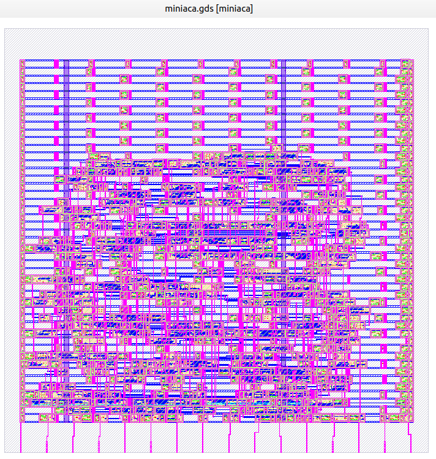

# miniACA — autómata celular asincrónico programable

**Módulo:** `miniaca`  
**Archivo RTL:** [`miniaca.v`](miniaca.v)  
**Testbench original:** [`miniaca_tb.v`](miniaca_tb.v)  
**Identificador Silicluster 2025:** `c2p9`

Diseño de cinco células lógicas, cada una con **cinco entradas**, que comparten una **regla programable de 32 bits**. La regla funciona como una tabla de consulta: cada vector de cinco entradas (valor de 0 a 31) selecciona un bit de `rule_table[31:0]`.

En modo normal, las salidas responden **asincrónicamente** a los cambios de las entradas. No existe un registro de estado propio por célula en el RTL; si se necesita realimentación, se realiza mediante el **cableado externo** de las entradas y salidas. El registro secuencial de 37 bits almacena únicamente la regla y la condición inicial.

## Puertos físicos y nombres del Verilog

| Puerto RTL | Nombre descriptivo | Dirección | Función |
| --- | --- | --- | --- |
| `i_clk` | `Clock` | Entrada | Reloj de programación (flanco ascendente) |
| `i_prg` | `Prog` | Entrada | `1`: programación / lectura de condición inicial; `0`: ejecución |
| `i_cx[4:0]` | `I[4:0]` | Entrada | Cinco conexiones entre células / entrada externa; en programación `I[0..2]` son control y datos |
| `i_c00` | `I0-1` (extremo) | Entrada | Entrada exterior, posición 0 de la célula 0 |
| `i_c01` | `I0-2` (extremo) | Entrada | Entrada común a las células 0 y 1 |
| `i_c43` | `I4-1` (extremo) | Entrada | Entrada común a las células 3 y 4 |
| `i_c44` | `I4-2` (extremo) | Entrada | Entrada exterior, posición 4 de la célula 4 |
| `o_cx[4:0]` | `O[4:0]` | Salida | Condición inicial en programación o salida de cada célula en ejecución |

**Nota de nombres:** las denominaciones `I0-1`, `I0-2`, `I4-1`, `I4-2` son descriptivas; los **identificadores exactos del RTL** son `i_c00`, `i_c01`, `i_c43`, `i_c44`. No se dispone aquí de un pinout numerado del chip encapsulado.

## Conexiones de las cinco células

En la tabla siguiente, las columnas van de bit 4 a bit 0 del índice de LUT.

| Célula | bit 4 | bit 3 | bit 2 | bit 1 | bit 0 |
| --- | --- | --- | --- | --- | --- |
| 0 | `i_cx[2]` | `i_cx[1]` | `i_cx[0]` | `i_c01` | `i_c00` |
| 1 | `i_cx[3]` | `i_cx[2]` | `i_cx[1]` | `i_cx[0]` | `i_c01` |
| 2 | `i_cx[4]` | `i_cx[3]` | `i_cx[2]` | `i_cx[1]` | `i_cx[0]` |
| 3 | `i_c43` | `i_cx[4]` | `i_cx[3]` | `i_cx[2]` | `i_cx[1]` |
| 4 | `i_c44` | `i_c43` | `i_cx[4]` | `i_cx[3]` | `i_cx[2]` |

Para cada `k` de 0 a 4:

```verilog
cell_out[k] = rule_table[cell_in[k]];
```

## Modo de programación (`i_prg = 1`)

Se activa un registro de desplazamiento de **37 flip-flops**:

```verilog
cfg_reg[36:32] = initial_state[4:0]; // Condición inicial: 5 bits
cfg_reg[31:0]  = rule_table[31:0];    // Regla/LUT: 32 bits
```

Las señales de programación se reutilizan de `i_cx`:

| Señal | Bit | Comportamiento |
| --- | --- | --- |
| `reset_cfg` | `i_cx[0]` | Si es `1` en el flanco ascendente de `i_clk`, carga la configuración predeterminada |
| `shift_en` | `i_cx[1]` | Si es `1` y no hay reset, desplaza un bit de `serial_data` |
| `serial_data` | `i_cx[2]` | Dato serial de configuración |

**Prioridad:** reset, luego habilitación de desplazamiento, luego retención del registro. El reset de configuración **es síncrono con `i_clk`** y sólo actúa con `i_prg = 1` (no borra a cero el registro).

Configuración predeterminada que carga el reset:

```verilog
{initial_state, rule_table} = {5'b01011, 32'h699695FF};
```

**Orden serial:** para cargar exactamente `{initial_state, rule_table}`, transmitir los **37 bits desde el bit 36 hasta el bit 0**, uno por flanco ascendente de `i_clk` con `shift_en = 1`. La operación RTL es:

```verilog
cfg_reg <= {cfg_reg[35:0], serial_data};
```

Durante todo el modo programación, **`o_cx[4:0] = initial_state[4:0]`**, incluido mientras se carga el registro; por tanto estas salidas pueden variar en el proceso de desplazamiento. La entrada `i_clk` no es un reloj de ejecución del autómata.

## Modo ejecución (`i_prg = 0`)

La salida de cada célula es el bit indexado de la regla cargada. **`o_cx[4:0] = cell_out[4:0]`**; ya no se muestra directamente la condición inicial. El valor inicial queda almacenado y se puede utilizar para iniciar una red con la conexión externa pertinente o volver a visualizarlo activando `i_prg`.

Los cuatro puertos de los extremos permiten conectar células de distintos circuitos para construir cadenas o anillos; también se puede realimentar una salida propia o de otra célula. Es necesario **definir explícitamente las conexiones externas** para cada topología. Un lazo combinacional no tiene una evolución discreta garantizada por reloj; conviene estudiar su estabilidad y temporización en una implementación real.

## Figuras, documentación y pruebas

- [Descripción funcional original (PDF)](docs/ASIC_automatas.pdf)
- [Layout GDS (imagen)](docs/miniaca_GDS.png)
- [Diagrama editable, versión actual](docs/miniaca.drawio)
- [Diagrama editable, versión anterior](docs/miniaca_esquema.drawio)
- [Testbench original](miniaca_tb.v) y [testbench autoverificable](tests/miniaca_autocheck_tb.v)



La figura del GDS es una **imagen del diseño físico** y no un esquema de pines del encapsulado.
