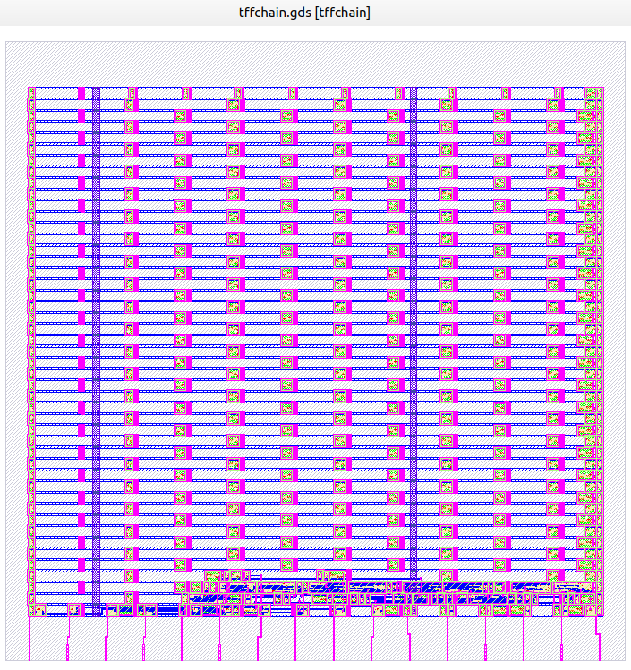

# retardos — cadena de flip-flops T (tffchain)

**Módulo:** `tffchain`  
**Archivo RTL:** [`tffchain.v`](tffchain.v)  
**Testbench original:** [`tffchain_tb.v`](tffchain_tb.v)  
**Identificador Silicluster 2025:** `c2p10`

El diseño incorpora **cinco cadenas independientes**, cada una con **dos flip-flops T** (total: 10 flip-flops). Cada entrada controla la primera etapa; la salida de la primera controla el reloj de la segunda. Ambas etapas alternan su estado ante un flanco positivo de su reloj.

## Puertos

| Puerto RTL | Dirección | Descripción |
| --- | --- | --- |
| `i_rst` | Entrada | Reset global **asincrónico**, activo en alto. Fuerza ambas salidas a cero |
| `i_x1[4:0]` | Entrada | Cinco relojes/señales independientes, uno por cadena |
| `o_x2[4:0]` | Salida | Salidas de las primeras etapas de TFF |
| `o_x4[4:0]` | Salida | Salidas de las segundas etapas de TFF |

## Estructura por canal `i` (0 a 4)

```text
 i_x1[i] ──(↑)──► [ TFF 1 ] ── o_x2[i] ──(↑)──► [ TFF 2 ] ── o_x4[i]
                         ▲                                ▲
                         └──────── i_rst (activo alto) ────┘
```

- Con `i_rst = 1`, ambos flip-flops se ponen en cero **sin esperar un flanco de reloj**.
- Con `i_rst = 0`, cada flanco ascendente de `i_x1[i]` conmuta `o_x2[i]`.
- Cada **flanco ascendente de `o_x2[i]`** conmuta `o_x4[i]`.
- Con pulsos periódicos, `o_x2[i]` tiene frecuencia aproximada `f_entrada/2` y `o_x4[i]` `f_entrada/4`, sin tener en cuenta los retardos físicos de propagación.
- Las cadenas son independientes: activar `i_x1[0]` no modifica las salidas de los otros cuatro canales.

### Ejemplo desde estado de reset

| Flancos ascendentes acumulados de `i_x1[i]` | `o_x2[i]` | `o_x4[i]` |
| ---: | :---: | :---: |
| 0 | 0 | 0 |
| 1 | 1 | 1 |
| 2 | 0 | 1 |
| 3 | 1 | 0 |
| 4 | 0 | 0 |

La salida de la segunda etapa conmuta en los flancos **1, 3, 5, ...** de la entrada (cuando la primera etapa pasa de 0 a 1). No se ofrece un retardo absoluto fijo: el circuito actúa como divisor por 2 y por 4. La asincronía entre dominios de reloj y los retardos de propagación deben considerarse al integrar el circuito.

## Figuras, documentación y pruebas

- [Descripción funcional original (PDF)](docs/ASIC_retardos.pdf)
- [Imagen del layout GDS](docs/tffchain_GDS.png)
- [Testbench original](tffchain_tb.v) y [testbench autoverificable](tests/tffchain_autocheck_tb.v)


